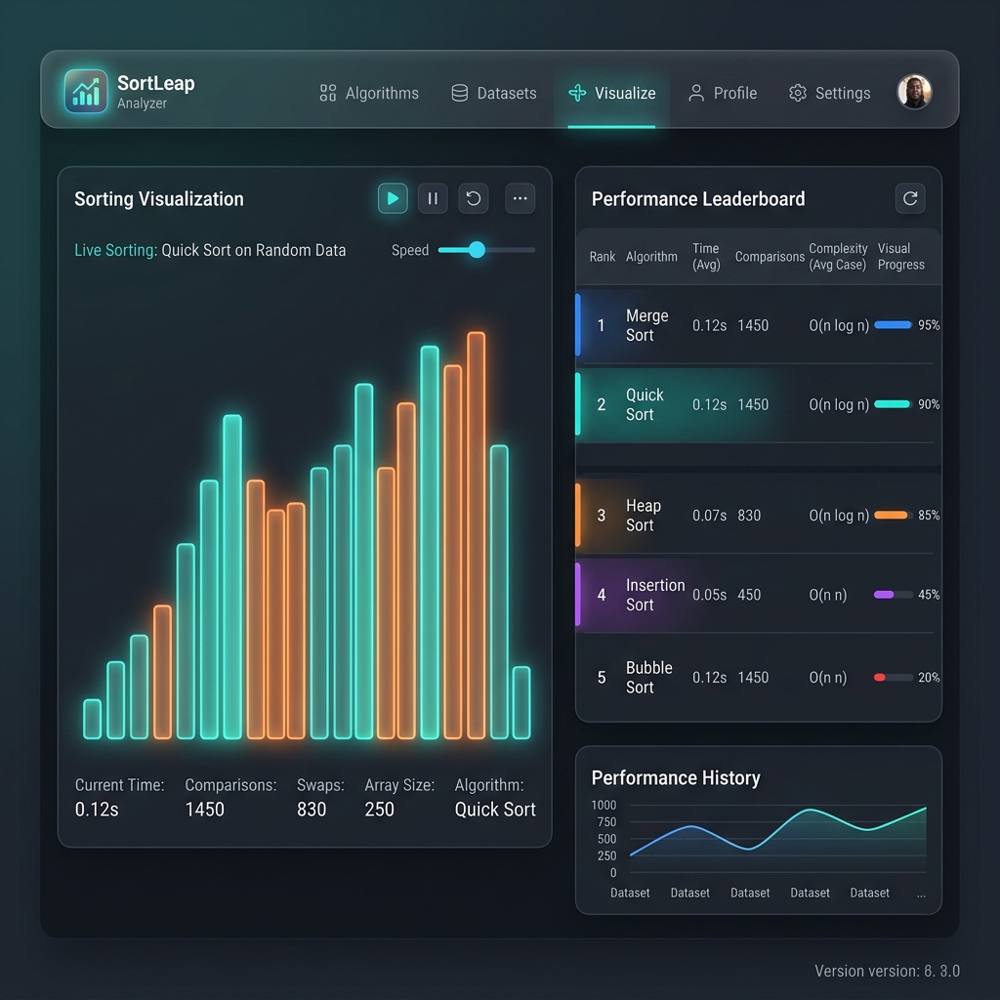

# 📊 Sorting Complexity Analyzer

A premium, interactive web-based sorting visualizer and complexity analyzer. This platform allows users to visualize standard sorting algorithms in real-time, compare their performance on identical datasets, and view detailed complexity statistics.

---

## 🌟 Features

- **📈 Real-Time Visualization:** Powered by Chart.js, rendering individual steps for comparisons and swaps.
- **🎨 Dynamic Highlighting:**
  - **Orange (`--accent-3`):** Highlights bars currently being compared.
  - **Red (`--accent-1`):** Highlights bars whose values/indices are changed/swapped.
- **🏆 Performance Leaderboard:** A dynamic summary table that automatically ranks completed algorithms from fastest to slowest, showing time in milliseconds, comparison counts, and swap metrics with custom speed progress bars.
- **⚙️ Custom Dataset Generation:**
  - Enter numbers manually via comma/space separated values.
  - Generate randomized arrays with custom size and range.
  - Load custom data from a plain text (`.txt`) file.
- **⏯️ Playback Controls:** Fully adjustable speed options (Fast, Normal, Slow) and Pause/Resume functionalities.
- **💾 Export Options:** Export the performance metrics as a CSV file or save the visualizer canvas state as a PNG.
- **📚 Theoretical Complexity Grid:** Reference table for Time (Best, Avg, Worst) and Space complexities.

---

## 📸 Demo Preview



---

## 🛠️ Algorithms Implemented

1. **Bubble Sort** - *O(n²)* average time
2. **Selection Sort** - *O(n²)* average time
3. **Insertion Sort** - *O(n²)* average time
4. **Merge Sort** - *O(n log n)* average time
5. **Quick Sort (Lomuto)** - *O(n log n)* average time
6. **Heap Sort** - *O(n log n)* average time
7. **Counting Sort** - *O(n + k)* average time
8. **Radix Sort (Base 10)** - *O(nk)* average time

---

## 🚀 How to Run Locally

Since this project utilizes ES modules (`type="module"`), it must be served through a local development web server to resolve imports correctly.

### Option 1: Live Server (VS Code Extension)
1. Open the project folder in VS Code.
2. Install the **Live Server** extension.
3. Click the **Go Live** button in the status bar (serves on port `5500` by default).

### Option 2: Node.js (npx)
If you have Node.js installed, run:
```bash
npx serve -l 5500
```
Then navigate to `http://localhost:5500` in your web browser.

---

## 👤 Credits

This is a personal project developed by **Mennatallah Essam Mounir**.
