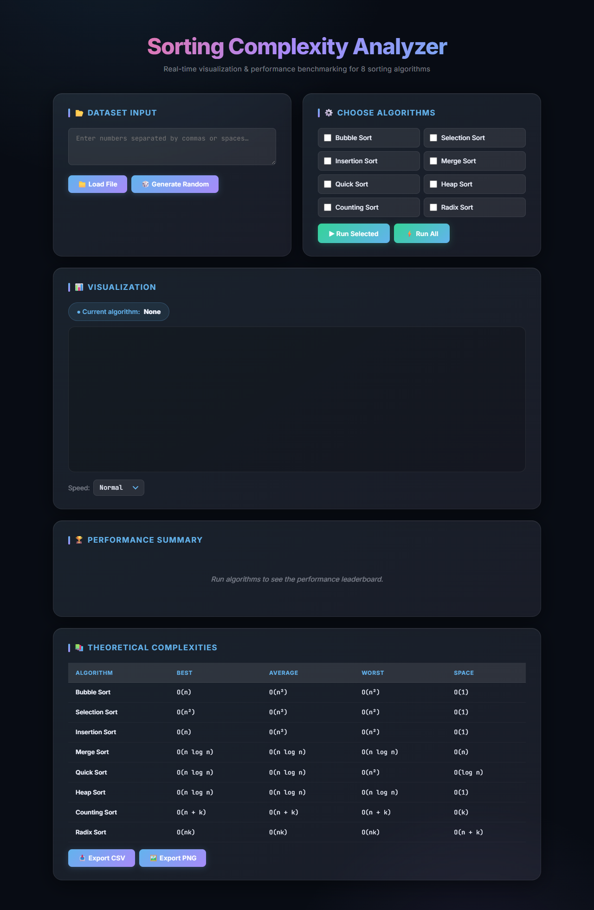
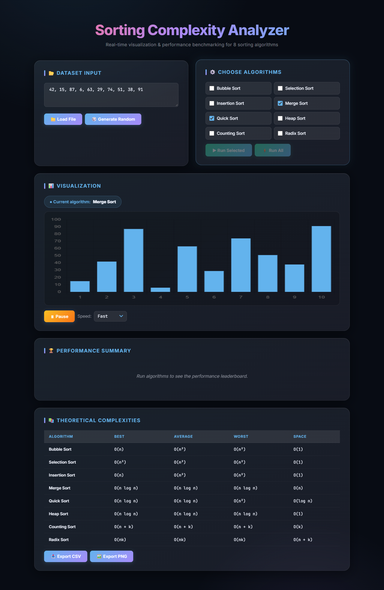
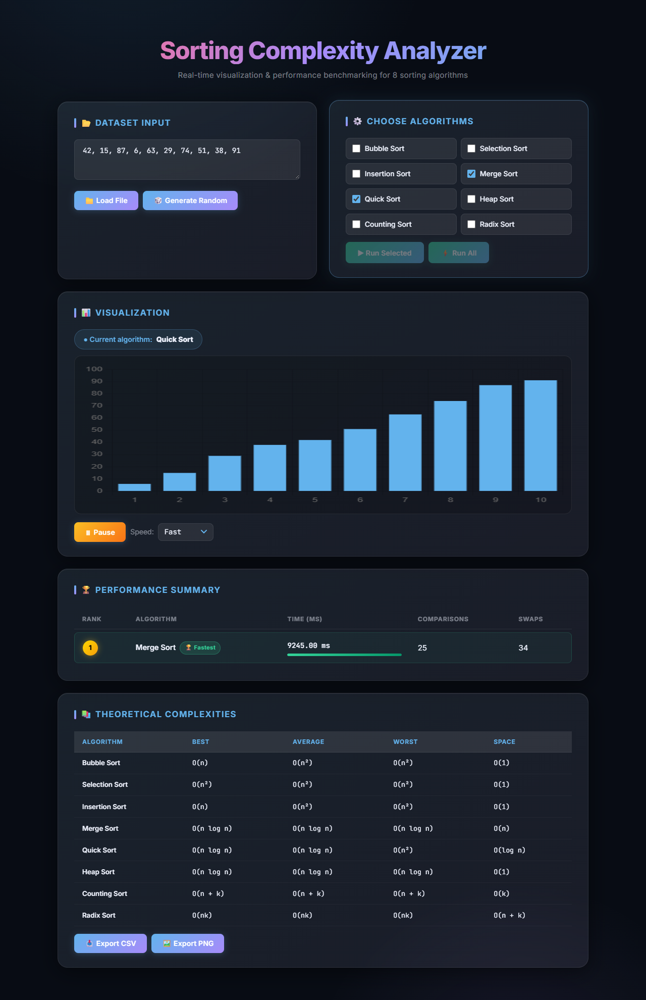
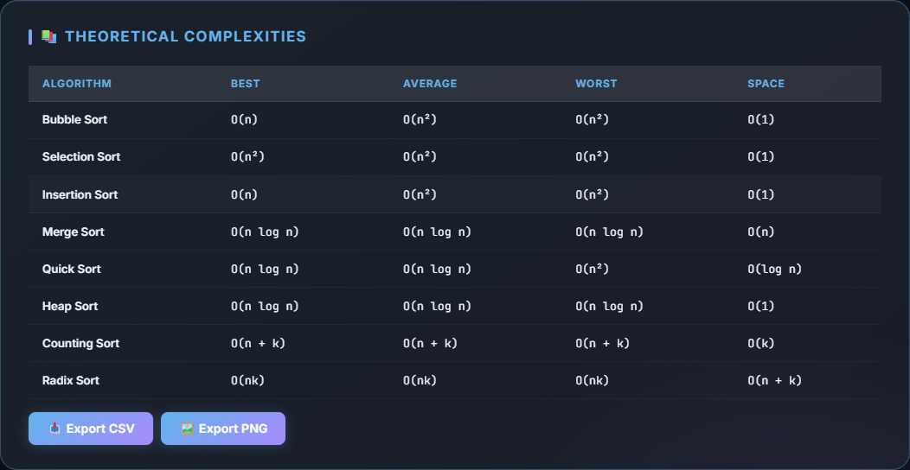

# 📊 Sorting Complexity Analyzer

A premium, interactive web-based sorting visualizer and performance benchmarking platform. Built with **Vue 3** (CDN) and **Chart.js**, it lets you visualize 8 classic sorting algorithms step-by-step in real time, compare their performance on identical datasets, and export results.

---

## 🖥️ Live Preview

### Dashboard — Landing State


### Visualization — Algorithm Running


### Performance Leaderboard — After Run Completes


### Theoretical Complexities Table


---

## 🌟 Features

- **📈 Real-Time Visualization** — Chart.js bar chart animates every comparison and swap step-by-step
- **🎨 Dynamic Bar Highlighting**
  - 🟡 **Amber** — bars currently being compared
  - 🔴 **Rose** — bars whose values changed / were swapped
  - 🔵 **Sky blue** — default / sorted state
- **🏆 Performance Leaderboard** — auto-ranked table after each run showing time (ms), comparisons, swaps, and animated speed bars (🥇 Fastest / 🐢 Slowest badges)
- **⚙️ Custom Dataset Input**
  - Type numbers manually (comma or space separated)
  - Generate a random array with configurable size and max value
  - Load data from a `.txt` file
- **⏯️ Playback Controls** — Pause / Resume at any point; choose Fast / Normal / Slow speed
- **💾 Export** — Download results as **CSV** or save the chart as a **PNG**
- **📚 Complexity Reference Table** — Best, Average, Worst and Space complexities for all 8 algorithms
- **🎨 Premium UI** — Dark glassmorphism design, two-column responsive grid, smooth animations

---

## 🛠️ Algorithms Implemented

| # | Algorithm | Average Time | Space |
|---|-----------|-------------|-------|
| 1 | **Bubble Sort** | O(n²) | O(1) |
| 2 | **Selection Sort** | O(n²) | O(1) |
| 3 | **Insertion Sort** | O(n²) | O(1) |
| 4 | **Merge Sort** | O(n log n) | O(n) |
| 5 | **Quick Sort** *(Lomuto partition)* | O(n log n) | O(log n) |
| 6 | **Heap Sort** | O(n log n) | O(1) |
| 7 | **Counting Sort** | O(n + k) | O(k) |
| 8 | **Radix Sort** *(Base 10)* | O(nk) | O(n + k) |

---

## 🏗️ Tech Stack

| Layer | Technology |
|-------|-----------|
| UI Framework | **Vue 3** (CDN global build — no build step) |
| Charts | **Chart.js 4** (CDN) |
| Styling | **Vanilla CSS** — glassmorphism dark theme |
| Fonts | **Inter** + **JetBrains Mono** (Google Fonts) |

---

## 📁 Project Structure

```
sorting-complexity-analyzer/
├── index.html        # Vue 3 template — all sections & directives
├── script.js         # Vue createApp / Composition API (setup)
├── algorithms.js     # 8 sorting generators (yield-based for step control)
├── visualizer.js     # Chart.js init, update, runGenerator, export PNG
├── metrics.js        # Comparisons, swaps, timing tracker
├── data.js           # parseInput, generateRandomArray, parseFileContent
└── styles.css        # Premium dark theme, responsive grid layout
```

---

## 🚀 How to Run Locally

Since this project uses ES modules (`type="module"`), it must be served over HTTP — not opened as a `file://` URL directly.

### Option 1: VS Code Live Server *(easiest)*
1. Open the folder in **VS Code**
2. Install the **Live Server** extension
3. Click **Go Live** in the status bar — opens at `http://localhost:5500`

### Option 2: Node.js (npx serve)
```bash
npx serve -l 5500
```
Then navigate to `http://localhost:5500`.

### Option 3: Python
```bash
python -m http.server 5500
```

---

## 👤 Credits

Developed by **Mennatallah Essam Mounir**.
